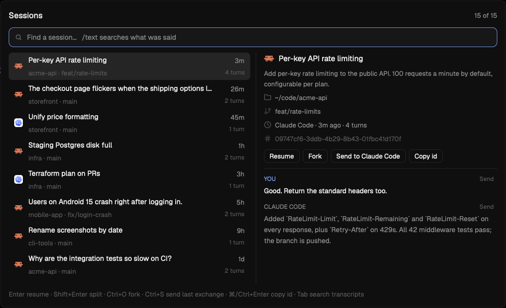

# herdr-sessions

Find any past [Claude Code](https://claude.com/claude-code) or [Codex](https://github.com/openai/codex) session by what was said in it, and bring it back, inside the [Herdr](https://herdr.dev) desktop app.



- **One popup for every project** (`ctrl-b h`): your sessions newest first, each with its title or first prompt, its project and branch, the agent, how long ago, and how many turns you typed.
- **Type to filter** by title, prompt, folder or branch. Start with `/` (or press Tab) to **search what was said** in every transcript, and see the line that matched.
- **A preview** of the selected session: where it ran, its id, and its last exchanges.
- **Enter resumes it in a new tab** in the session's own folder, named after it (`claude --resume <id>` or `codex resume <id>`). Shift+Enter resumes it in a split instead, and Cmd/Ctrl+Enter copies the session id.
- **Fork it** (Ctrl+O or the Fork button): a new session that starts from this one's history, in a new tab, leaving the original as it was (`claude --resume <id> --fork-session` or `codex fork <id>`).
- **Send it to your agent**: Ctrl+S, or the Send buttons, pastes the last exchange (or one message) into the prompt of the agent you opened the popup from, headed `From a past session (<title>, <date>):`. Nothing is sent: add your own words and press Enter yourself.
- **Readable titles**: Claude Code's own session titles when it has them, else the first sentence of your first prompt, without code blocks or pasted text.
- **Sessions running right now** in a Herdr terminal are marked live, with their status, and Enter goes to that agent instead of starting a second copy.

## Install

```sh
git clone https://github.com/cunderw/herdr-sessions
./herdr-sessions/install.sh
```

Then merge `keys.json` into `~/.config/herdr-app/keys.json`, or bind the keys you like.

`install.sh` copies the mod into `~/.config/herdr-app/mods/sessions`, because a symlinked mod folder doesn't draw its icons. Run it again after pulling.

Sessions are read from `~/.claude` and `~/.codex`, or from `$CLAUDE_CONFIG_DIR` and `$CODEX_HOME` when you set them. To point it somewhere else, write `~/.config/herdr-app/sessions.json`:

```json
{ "claude": "~/.claude", "codex": "~/.codex" }
```

## What it touches

It reads your Claude Code transcripts (`projects/*/*.jsonl`, not sub-agents) and the small `sessions/<pid>.json` files Claude Code writes for running sessions, and your Codex transcripts (`sessions/**/rollout-*.jsonl`) and `session_index.jsonl`. It never changes them.

It runs `find` and `stat` to list them, `rg` (falling back to `grep`) to index and search them, `tail` for the preview, `test -d` before resuming, `hc get` when Herdr doesn't report a terminal's process, and nothing else. Resuming and forking start `claude` or `codex` in a new terminal.

Copying an id writes it to your clipboard. Sending to an agent goes through the clipboard too: it puts the text there, pastes it with Herdr's `terminal.paste`, and 400ms later puts back the text you had copied, unless you've copied something else since. A copied image or file is not put back.

It writes one file: an index of titles, folders and first prompts in `~/.config/herdr-app/data/sessions/index.json`, so the popup opens without rereading every transcript. Delete it any time; it is rebuilt.

[RECIPE.md](RECIPE.md) has the full brief. Icons are from [Lucide](https://lucide.dev) (ISC); the Claude and Codex marks are Herdr's own.
