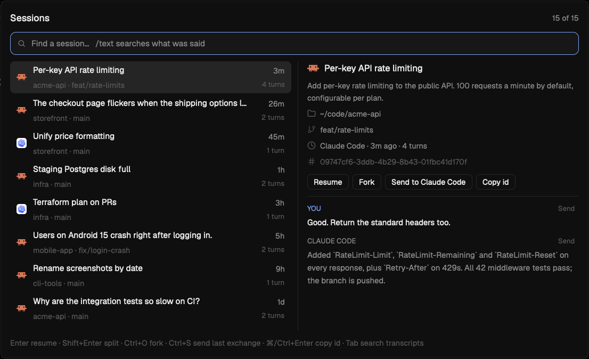

# Agent sessions

A popup that finds any past Claude Code or Codex session, across every project, by its title, folder or what was said in it. It previews the selected session's last exchanges and brings it back in a new tab in its own folder, forks it into a new session, or goes to it when it is still running in a Herdr terminal. It can also paste an exchange from it into the prompt of the agent you're working with, unsent, so you can carry context from one session to another.



## What you see

- **The popup**, 920 by 560px, 40px from the top of the window, on `popover`, with 14px padding and 10px gaps.
  - A heading row. On the left, "Sessions" (or "Search transcripts" in text search) in 15px semibold `foreground`, then "N live" in 12px `dim` when any session is running. On the right, "shown of total" in 12px `muted`.
  - A 36px input with 9px corners and an `accent` border on `raised`, with a 14px Lucide icon (`search`, or `text-search` in text search) in `muted`. Placeholder: `Find a session…   /text searches what was said`.
  - The body, side by side:
    - **The list**, 450px wide. Rows are 50px tall with 7px corners and 2px between them; the selected row is `selected` and hovered rows are `hover`. Each row has:
      - the agent's 16px mark on the left (Herdr's own `icons/claude.svg` or `icons/codex.svg`, drawn with `image()`)
      - the title or first prompt in 13px `foreground`, truncated, over the project folder's name and branch in 12px `dim` (`acme-api · feat/rate-limits`). The home folder shows as `~`.
      - on the right, how long ago in 12px `muted` (`now`, `27m`, `5h`, `4d`, `Oct 12`), over the turn count in 11px `dim` (`4 turns`)
      - a running session shows a 7px dot in its status color (`working`, `blocked`, `done`, `idle`) and the word `live` in `foreground` instead of the age
      - In text search, the second line is the project, then the text that matched, in `muted`.

      The list shows as many rows as fit its measured height and keeps the selection in the middle.
    - **The preview** fills the rest, with a 1px `border` line on its left and 14px padding.
      - The agent's 18px mark and the headline in 14px semibold. When the headline isn't the first prompt word for word, the prompt follows in 12px `muted` (up to 160 characters).
      - Meta lines, each a 13px Lucide icon in `dim` and 12px text: `folder` and the folder (home as `~`), `git-branch` and the branch, `clock` and `Claude Code · 4m ago · 4 turns`, `hash` and the session id in `dim`. A running session adds an 8px status dot and `Running in <space> / <tab> · <status>`.
      - A row of 24px buttons with 6px corners, a 1px `border` outline and 12px text, `hover` on hover: **Resume** (**Show** for a running session), **Fork**, **Send to <agent>** (named after the program in the terminal the popup opened over, e.g. `Send to Claude Code`; `dim` and inert when there is none or nothing to preview) and **Copy id**.
      - A 1px `border` divider, then the last exchanges, oldest first: a 11px semibold label (`YOU` in `accent`, the agent's name in caps in `muted`) with a small **Send** link on the right (11px `dim`, `accent` on `hover` when hovered), over the text in 12.5px (`foreground` for you, `muted` for the agent). Your messages are cut at 280 characters and the agent's at 420 on screen; Send uses the whole message.
  - A footer in 12px `dim`: `Enter resume · Shift+Enter split · Ctrl+O fork · Ctrl+S send last exchange · ⌘/Ctrl+Enter copy id · Tab search transcripts`.

## How it behaves

- `ctrl-b h` opens the popup (`mod.open:sessions`); pressing it again closes it.
- The list is every session, newest first by file time. It appears at once from the index saved last time, then updates with any transcript that changed since.
- Typing filters the list. Every word must appear in the title, the first prompt, the folder path, the branch or the agent's name (`codex` lists Codex sessions).
- `/words` searches inside every transcript, case-insensitively, 180ms after typing stops. Only what was said counts: your typed prompts and the agent's text, not tool calls, tool output, hook output or request logs. Each session shows the first match, with about 60 characters before it and 100 after. Tab switches between filtering and text search.
- Up/Down, Ctrl+N/P, Ctrl+J/K (from `keys.json`) and the scroll wheel move the selection, which wraps around. Page Up/Down move a page. A click selects a row; clicking the selected row acts on it, with the same modifiers as Enter.
- The preview loads 90ms after the selection rests, from the last 256 KB of the transcript. When an agent wrote several messages in a row, only its last one in that turn is shown. When the tail has none of your prompts, the first prompt from the index stands in.
- **Enter** on a session that isn't running opens a new tab named after it (32 characters at most) in the session's folder, running `claude --resume <id>` or `codex resume <id>`. **Shift+Enter** opens it in a split to the right of the focused pane instead. **Cmd+Enter** (Ctrl+Enter elsewhere) copies the session id and shows a toast.
- If the session's folder no longer exists (a removed worktree), Enter shows an error toast naming the folder and the resume command, and starts nothing.
- **Enter or Shift+Enter on a live session** runs `agent.focus` on its terminal, switching to its space and tab, instead of starting a second copy. The Resume button reads **Show** then.
- **Fork** (Ctrl+O or the Fork button) opens a new tab named `fork: <headline>` in the session's folder running `claude --resume <id> --fork-session` or `codex fork <id>`. The fork gets a new session id and the original transcript is left as it was. A running session can be forked too.
- **Send** pastes into the terminal that had focus when the popup opened, and closes the popup there. Ctrl+S (or the Send to button) sends the last exchange: your last prompt in the preview and the agent's answer to it. A message's own Send link sends just that message. The text is:

  ```
  From a past session (<headline>, <YYYY-MM-DD of the last change>):

  You: <your prompt>

  Claude Code: <its answer>
  ```

  It arrives as one paste and is not submitted, so you can add to it and press Enter. Opening the popup over a mod pane leaves Send inert.
- The preview leaves out replies to messages a tool or another session injected as "user" messages, so an exchange is always your prompt and the answer to it.
- Live marks refresh every 4 seconds while the popup is open. Agent statuses (working, blocked, done, idle) show as the dot's color, in the list and the preview.
- Escape closes the popup.
- **Titles.** The headline is, in order: the title Claude Code generated (`ai-title`), a title you gave the session (`custom-title`, unless it only repeats the folder name, like `--name api` or `api (main)`), a `summary` record (written by older Claude Code versions), Codex's thread name from `session_index.jsonl`, then a short title made from the first prompt you typed, with no model call: pasted text (`<pasted_content>`) is left out when you also wrote something, then code blocks and leading Markdown markers (`#`, `-`, `>`, `1.`); the first line with words is cut at its first sentence end (`.`, `?` or `!` followed by a space), unless that leaves fewer than 16 characters; then cut at a word boundary to 80 characters with `…`. A session whose only prompts are slash commands is headed by the first one (`/dream --full`).
- **Turns** are the prompts you typed, slash commands included, and not what tools or other sessions injected as user messages.

## Built from

- One mod, `mods/sessions/`. `mod.json` is `{ "place": "none", "overlay": { "kind": "popup", "at": "top", "offset": 40, "width": 920, "height": 560 } }`, so nothing docks into a layout.
- `main.js` is the popup view. `sessions.js` holds the rest: finding the folders, listing, indexing and caching, matching, transcript search, the preview, live detection, resuming and copying.
- Where the sessions are: `sessions.json` in Herdr's home (`{ "claude": "~/.claude", "codex": "~/.codex" }`, both optional), else `$CLAUDE_CONFIG_DIR` and `$CODEX_HOME` (read once with `sh -c printf`), else `~/.claude` and `~/.codex`.
- **Claude Code** keeps `<claude>/projects/<folder slug>/<session id>.jsonl`, one JSON record per line. Sub-agents are in `<session id>/subagents/`, a level deeper, and are left out. The slug is lossy, so the folder comes from the records' `"cwd"` and the branch from `"gitBranch"`. A typed prompt is a record with `"message":{"role":"user","content":"<string>"}`; tool results have an array there. Titles are lines that start `{"type":"ai-title","aiTitle":…}`, `{"type":"custom-title","customTitle":…}` or (older versions) `{"type":"summary","summary":…}`, and the last of each kind wins. The patterns are anchored to the line start, because tool inputs such as SendMessage's carry a `"summary"` key too.
- **Codex** keeps `<codex>/sessions/YYYY/MM/DD/rollout-<time>-<id>.jsonl`. Line 1 is `session_meta` with `cwd`, `thread_source` and `git.branch`. Only `thread_source: "user"` sessions are listed; `guardian_review` and `subagent` threads are Codex talking to itself. Prompts are `response_item` messages with role `user` and `input_text`; the agent's are role `assistant` and `output_text`. Thread names are in `<codex>/session_index.jsonl`, newest last.
- What doesn't count as a prompt: text starting with an XML-style tag (`<task-notification>`, `<local-command-caveat>`, `<bash-input>`, `<system-reminder>`, `<environment_context>`, `<turn_aborted>`, `<hc>` and the like, except `<pasted_content>`), `Another Claude session…`, `This session is being continued…`, `Stop hook feedback`, `Caveat:`, `[Request interrupted`, and `# AGENTS.md instructions`. `<command-name>/x</command-name>` with `<command-args>` becomes `/x args`.
- Indexing a file never reads it whole. One `find … -exec stat` lists every transcript with its mtime and size. Only files that are new or changed are indexed, 60 per call, with two `rg -o` passes: one with `-m 1` for the folder and branch, one for prompt openings (the first 240 characters) and titles. The patterns use plain groups so the same ones work with `grep -E` when `rg` is missing. The result is saved to `~/.config/herdr-app/data/sessions/index.json` (version, the folders it was built from, and per file its mtime, size, id, folder, branch, title, first prompt and turn count).
- Transcript search is one `rg -i -m 1 -o -r '$hit'` over the listed files with a pattern that starts at a prompt or text block's opening quote and stays inside that JSON string. The search text is JSON-escaped, then regex-escaped. Without `rg`, it falls back to `grep -i -m 1 -o -E '.{0,60}text.{0,100}'`, which also matches outside messages.
- Live sessions: for each local agent in `agents()`, the terminal's `foreground` from `terminals()` (or `hc get <address> --json` when missing) gives its command line and pid. Claude Code writes `<claude>/sessions/<pid>.json` with its current `sessionId`, which is read for Claude agents. Any agent whose command line is `--resume <id>`, `-r <id>`, `--session-id <id>` or `resume <id>` is matched by that id.
- Herdr functions: `props`, `theme`, `settings`, `nextCommand`, `notify`, `closeOverlay`, `run`, `agents`, `terminals`, `exec`, `hc`, `home`, `appHome`, `readTextFile`, `window`; `fs/promises` (`readFile`, `writeFile`, `mkdir`) for the index.
- Commands: `terminal.open {argv, folder, place: "tab", name}` and `{argv, folder, place: "right"}`, `agent.focus {terminal}`, `pane.focus {terminal}`, `terminal.paste`, `mod.open`.
- The send target is `focused().terminal` read in `init`, while the popup is opening: the popup is an overlay, not a pane, so that is the terminal under it. Its name is the program's (`agents()`, else `panes()`).
- Programs: `sh`, `find`, `stat`, `rg` or `grep`, `tail`, `test`, `hc`, `pbcopy` and `pbpaste` (`clip`; `wl-copy`/`wl-paste`, `xclip` or `xsel`).
- `keys.json`'s `mod:sessions` section binds `sessions.next`, `sessions.prev`, `sessions.fork` and `sessions.send`; the popup also handles Ctrl+O and Ctrl+S itself, and ignores the same action twice within 400ms in case both see the key.
- Icons: Lucide (ISC) `search`, `text-search`, `folder`, `git-branch`, `clock` and `hash`, drawn with `svg()` and tinted. The agent marks are Herdr's shipped `icons/claude.svg` and `icons/codex.svg`.

## Watch out

- **Typing into an agent's prompt without submitting it.** `hc send` is the wrong tool: it wraps the text in `<hc from=…>` tags and presses Enter. `hc keys` takes key names only, and the hc API has no raw-input method short of a framed `terminal.attach` stream. What works is the clipboard and Herdr's own paste, which arrives as one bracketed paste:

  ```js
  await exec("sh", ["-c", 'printf %s "$1" | pbcopy', "sh", text]);  // wl-copy / xclip / clip elsewhere
  run("pane.focus", { terminal });   // terminal.paste takes no target
  run("terminal.paste");             // pastes into the focused terminal
  ```

  From a shell it's `printf %s "$TEXT" | pbcopy; herdr-app do pane.focus --terminal t7; herdr-app do terminal.paste`. Claude Code shows `[Pasted text #1 +4 lines]` in its prompt and stays idle. Without the `pane.focus`, the text goes wherever the person is typing. Save the clipboard first (`pbpaste`) and put it back: the restore here is an `exec` of `sleep 1; pbcopy` started before the popup closes, because an `exec` already started outlives the copy that started it, while its tasks are cancelled.

- **Install by copying, not by symlinking the folder.** A symlinked mod folder loads its JavaScript but draws no icons. `install.sh` copies the files in.
- **Always pass `rg --no-ignore --no-config`.** People keep `~/.claude` in git with an ignore-everything `.gitignore`, and rg reads ignore files from parent folders, so a plain `rg` silently finds no transcripts. `--no-config` keeps a `RIPGREP_CONFIG_PATH` from adding flags.
- **`exec` output is capped at 8 MiB and 30 s, and `readTextFile` at 1 MiB.** Transcripts run to tens of MB and single lines (tool results) to several MB, so never print whole lines: use `-o` with bounded windows, and `tail -c` for the preview. Indexing in chunks keeps each call small.
- **Grep's `{m,n}` bound stops at 255**, so the prompt window is 240 characters, and ERE has no `(?:…)`.
- Most Claude records have no `origin` or `promptSource` field, so prompts are told apart by their text, not by metadata. A long session can have thousands of `Another Claude session` messages from other agents.
- The Codex session id is the UUID in the file *name*; a UUID elsewhere in the path (a temp folder, say) must not be taken for it.
- `on_size_change` reports sizes with the app's zoom applied, so divide by `settings().zoom` before comparing with layout values. A popup sizes to its content, so the root gets a fixed height, or it shrinks while you type.
- `toLocaleString` with options isn't available; month names are spelled out.
- `codex fork <id>` and `codex resume <id>` come from `codex --help` (codex-cli 0.164); `codex fork` needs the session id, or it opens a picker.
- Claude Code's `--fork-session` writes the fork's transcript only once you type in it, so an untouched fork leaves no new session in the list.
- `terminal.open` with `place: "tab"` runs the command through your interactive shell, so a shell function named `claude` applies. A split (`place: "right"`) runs the program directly.
- Claude Code keeps the same session id when resumed, so the resumed copy is found live through its pid file. A Codex session started fresh (not with `codex resume <id>`) can't be matched to its terminal, because Codex writes no pid file and doesn't hold its transcript open; it shows as not live.
- Live detection is for this machine only; agents on other machines are skipped.
- Claude Code asks whether to trust a folder the first time it starts there, and a resumed session in a temp folder will ask.
- `ctrl-b h` is a suggestion. `ctrl-j`/`ctrl-k` only apply while the popup has the keyboard.

## Done when

- `herdr-app check mods/sessions` passes.
- `herdr-app do mod.open --name sessions` lists Claude Code and Codex sessions newest first, each with a headline, project, branch, age and turn count, and the first one previewed on the right.
- Typing a project name narrows the list; `/` and a word from an old conversation lists the sessions where it was said, with the matching text.
- Enter on a finished session opens a tab named after it, in its folder, and the agent shows the earlier conversation. Shift+Enter does the same in a split.
- That resumed session now shows `live`, and Enter on it switches to its tab without opening another.
- Cmd/Ctrl+Enter puts the session id on the clipboard.
- Opened over an agent, Ctrl+S puts `From a past session (…):` and the last exchange into that agent's prompt as one paste, unsent, and the clipboard holds what it held before a second later.
- Fork opens a tab named `fork: …` whose agent shows the earlier conversation under a new session id; the original transcript's size and time don't change.
- A session whose first prompt is a long paragraph is headed by its first sentence.
- A second open of the popup lists the sessions immediately from `data/sessions/index.json`.
